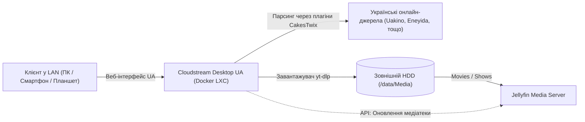

# Дорожня карта розвитку (Roadmap)
## Cloudstream Desktop UA (з підтримкою завантажень для Jellyfin)

> **Мета проекту:** Створити зручний, повністю українізований self-hosted медіацентр на базі Cloudstream Desktop, який дозволяє в один клік із будь-якого пристрою у локальній мережі ставити на завантаження українські фільми, серіали та сезони безпосередньо на зовнішній HDD (Proxmox), з миттєвою появою в бібліотеці Jellyfin.

---

## Загальна архітектура

---

## Етапи розробки (Гілки розробки)

### 🚀 Етап 1: Повна українська локалізація інтерфейсу
**Гілка:** `feature/ukrainian-language`
* [ ] **Переклад головного інтерфейсу:**
  * Головна навігація: «Головна» (Home), «Пошук» (Search), «Медіатека» (Library), «Завантаження» (Downloads), «Налаштування» (Settings).
  * Елементи сторінки тайтлу: «Дивитися онлайн», «Продовжити перегляд», «Опис», «Трейлер», «Актори», «Сезони та серії».
* [ ] **Переклад налаштувань:**
  * Розділи джерел, плагінів, пріоритетів якості та провайдерів.
* [ ] **Локалізація плеєра:**
  * Кнопки вибору аудіодоріжки (дубляж/озвучка), субтитрів, якості та швидкості відтворення.
* [ ] **Українська мова за замовчуванням:**
  * Налаштування системної локалі браузера та контейнера на `uk_UA.UTF-8`.

---

### 📥 Етап 2: Менеджер завантажень для фільмів, серій та сезонів
**Гілка:** `feature/downloads`
* [x] **Базовий бекенд завантажень:**
  * Сервіс `DownloadService` з чергою завдань та інтеграцією з `yt-dlp`.
  * Багатопотоковий викачувач HLS-потоків (`--concurrent-fragments 5`).
* [x] **Кнопки в інтерфейсі:**
  * Кнопка «Завантажити» для фільмів.
  * Кнопка «Завантажити сезон» для активного сезону.
  * Іконка завантаження біля кожної серії.
* [x] **Окремий екран «Завантаження» (`/downloads`):**
  * Відображення прогресу (%), швидкості скачування (МБ/с), розрахункового часу (ETA).
  * Кнопка скасування активного завантаження.
  * Кнопка очищення завершених завдань.
* [ ] **Покращення та розширення:**
  * Вибір бажаної роздільної здатності перед стартом (1080p / 720p).
  * Автоматичне завантаження зовнішніх субтитрів (`.srt` / `.vtt` / `.ass`) поруч із відеофайлом.
  * Автоматичне відновлення перерваних завантажень після перезапуску контейнера.

---

### 💽 Етап 3: Керування сховищем Proxmox та інтеграція з Jellyfin
**Гілка:** `feature/storage-management`
* [x] **Стандартизована структура Jellyfin:**
  * Фільми: `/data/Media/Movies/{Назва} ({Рік})/{Назва} ({Рік}).mp4`
  * Серіали: `/data/Media/Shows/{Назва}/Season {01}/{Назва} - S{01}E{01}.mp4`
* [x] **Прокидання томів у Docker:**
  * Монтування `/data/Media/Movies` та `/data/Media/Shows` у `docker-compose.yml` та `docker run`.
* [ ] **Налаштування через вебінтерфейс:**
  * Сторінка в налаштуваннях для введення URL Jellyfin та API-ключа.
  * Можливість зміни шляхів до папок без редагування файлів конфігурації.
* [ ] **Моніторинг вільного місця:**
  * Віджет вільного та зайнятого місця на підключеному HDD у розділі «Завантаження».
* [ ] **Автоматичний тригер оновлення Jellyfin:**
  * Миттєвий виклик `/Library/Refresh` одразу після збереження файлу.

---

### 📱 Етап 4: Мобільний досвід та автоматизація
**Гілка:** `feature/mobile-and-automation`
* [ ] **Адаптивний UI для смартфонів:**
  * Зручне керування завантаженнями з телефона однією рукою.
* [ ] **PWA (Progressive Web App):**
  * Можливість встановити як застосунок на головний екран iOS / Android.
* [ ] **Сповіщення:**
  * Браузерні сповіщення про завершення завантаження сезону чи фільму.
* [ ] **Автоматичне очищення:**
  * Видалення залишкових тимчасових файлів у разі збоїв інтернету.

---

## Розклад релізів та версій

| Версія | Ціль | Статус |
| :--- | :--- | :--- |
| **v1.0-alpha** | Початковий форк, додавання базового менеджера завантажень і Docker CI/CD | ✅ Завершено |
| **v1.1** | Повна українська локалізація інтерфейсу (`feature/ukrainian-language`) | ⏳ В процесі |
| **v1.2** | Розширені налаштування якості завантажень і субтитри (`feature/downloads`) | 📅 Заплановано |
| **v1.3** | Повне керування дисками Proxmox та автооновлення Jellyfin (`feature/storage-management`) | 📅 Заплановано |
| **v2.0** | Стабільний реліз із мобільним PWA та сповіщеннями | 📅 Заплановано |
