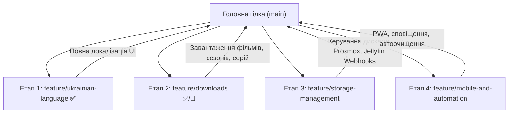

# 🗺️ Cloudstream Desktop UA — Roadmap (Дорожня карта розвитку)

> Репозиторій: [https://github.com/Mylevsky/cloudstream-desktop-ua](https://github.com/Mylevsky/cloudstream-desktop-ua)  
> Docker Image: `ghcr.io/mylevsky/cloudstream-desktop-ua:latest`

Цей документ описує етапи розробки та дорожню карту покращень проекту **Cloudstream Desktop UA**, адаптованого для україномовних користувачів, домашніх медіасерверів (Proxmox VE / Jellyfin) та зручного завантаження фільмів і серіалів.

---

## Загальна схема етапів

---

## 📌 Етап 1: Повна українська локалізація вебінтерфейсу (Завершено ✅)
* **Гілка:** `feature/ukrainian-language` (злито в `main`)
* **Виконано:**
  * Повна локалізація всіх 26 компонентів і сторінок інтерфейсу SvelteKit:
    * Головна сторінка, вітрини, слайдери, категорії та жанри
    * Сторінка перегляду тайтлу (фільм/серіал), сезони, списки епізодів
    * Пошук, категорійні фільтри, автокомпліт, лічильники результатів
    * Медіатека (історія переглядів, закладки, контекстні дії)
    * Веб-плеєр (керування жестами, субтитри, аудіодоріжки, швидкість, розмір)
    * Сторінка та модальні вікна налаштувань (пріоритети джерел, плагіни, автооновлення)
    * Екран активації та сполучення пристроїв (Pairing / Activate)
    * Менеджер завантажень (черга, прогрес, статуси)
  * Встановлення української мови (`uk`) як основної мови веб-додатку.
  * Форматування відносного часу українською мовою.

---

## 📌 Етап 2: Вбудований менеджер завантажень для Jellyfin (Реалізовано / Тестування 🧪)
* **Гілка:** `feature/downloads` (включено в `main`)
* **Основний функціонал:**
  * Завантаження фільмів однією кнопкою з автоматичним збереженням у `/data/Media/Movies/{Title} ({Year})/{Title} ({Year}).mp4`
  * Завантаження окремих серій у структуру `/data/Media/Shows/{Title} ({Year})/Season {S}/{Title} - S{S}E{E}.mp4`
  * Завантаження **всього сезону** серіалу в один клік із послідовною чергою та контролем помилок.
  * Інтеграція фонового завантажувача з підтримкою HLS/DASH потоків через вбудований бекенд `yt-dlp`.
  * Сторінка `/downloads` для моніторингу прогресу, швидкості та розміру файлів.

---

## 📌 Етап 3: Керування сховищем Proxmox та інтеграція з Jellyfin
* **Гілка:** `feature/storage-management`
* **Завдання:**
  * Налаштування параметрів Jellyfin у веб-інтерфейсі (URL сервера Jellyfin та API токен).
  * Автоматичний виклик Jellyfin Library Refresh API після успішного завантаження файлу.
  * Відображення вільного місця на підключених точках монтування Proxmox (`/data/Media`).
  * Попередження у разі нестачі місця на диску.

---

## 📌 Етап 4: Мобільний досвід та розширена автоматизація
* **Гілка:** `feature/mobile-and-automation`
* **Завдання:**
  * PWA маніфест та сервіс-воркер для зручного встановлення додатку на телефон/планшет.
  * Push-сповіщення у браузері про завершення завантаження фільму або сезону.
  * Можливість автоматичного видалення тимчасових `.part` файлів у разі збоїв.
