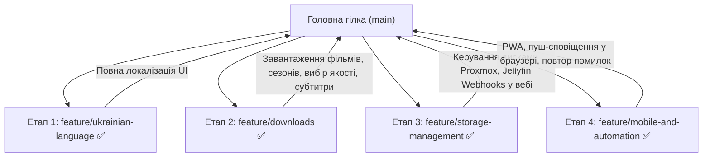

# 🗺️ Cloudstream Desktop UA — Roadmap (Дорожня карта розвитку)

> Репозиторій: [https://github.com/Mylevsky/cloudstream-desktop-ua](https://github.com/Mylevsky/cloudstream-desktop-ua)  
> Docker Image: `ghcr.io/mylevsky/cloudstream-desktop-ua:latest`

Цей документ описує етапи розробки та дорожню карту покращень проекту **Cloudstream Desktop UA**, адаптованого для україномовних користувачів, домашніх медіасерверів (Proxmox VE / Jellyfin) та зручного завантаження фільмів і серіалів.

---

## Загальна схема етапів

---

## 📌 Етап 1: Повна українська локалізація вебінтерфейсу (Завершено ✅)
* **Гілка:** `feature/ukrainian-language` (злито в `main`)
* **Виконано:**
  * Повна локалізація всіх 26 компонентів і сторінок інтерфейсу SvelteKit.
  * Встановлення української мови (`uk`) як основної мови веб-додатку.
  * Форматування відносного часу українською мовою.

---

## 📌 Етап 2: Вбудований менеджер завантажень (Завершено ✅)
* **Гілка:** `feature/downloads` (злито в `main`)
* **Виконано:**
  * Завантаження фільмів однією кнопкою з автоматичним збереженням у `/data/Media/Movies/{Title} ({Year})/{Title} ({Year}).mp4`.
  * Завантаження окремих серій у структуру `/data/Media/Shows/{Title}/Season {S}/{Title} - S{S}E{E}.mp4`.
  * Завантаження **всього сезону** серіалу в один клік із послідовною чергою та контролем помилок.
  * Вибір бажаної якості завантаження у налаштуваннях (Найкраща / 1080p / 720p / 480p).
  * Автоматичне виявлення та завантаження українських субтитрів поруч із відеофайлом (`.uk.srt`, `.uk.vtt`).
  * Сторінка `/downloads` для моніторингу прогресу, швидкості та залишкового часу в реальному часі.

---

## 📌 Етап 3: Керування сховищем Proxmox та інтеграція з Jellyfin (Завершено ✅)
* **Гілка:** `feature/storage-management` (злито в `main`)
* **Виконано:**
  * Вкладка **📁 Сховище та Jellyfin** у налаштуваннях вебінтерфейсу.
  * Графічний індикатор вільного та зайнятого місця на підключеному диску Proxmox (`/data/Media`).
  * Перевірка доступності та прав на папки фільмів і серіалів.
  * Налаштування URL та API-ключа сервера Jellyfin безпосередньо у веб-панелі.
  * Інструмент миттєвої перевірки з'єднання з сервером Jellyfin.
  * Автоматичний виклик Jellyfin Library Refresh API після успішного завантаження кожного файлу.
  * Кнопка ручного виклику оновлення бібліотеки Jellyfin.
  * Віджет з кількістю вільного місця у шапці менеджера завантажень.

---

## 📌 Етап 4: Мобільний досвід та розширена автоматизація (Завершено ✅)
* **Гілка:** `feature/mobile-and-automation` (злито в `main`)
* **Виконано:**
  * **Український PWA:** оновлено веб-маніфест (`Cloudstream Desktop UA`), іконки та параметри запуску для швидкого встановлення як нативний додаток на телефони та планшети.
  * **Web Notifications у браузері:** інтеграція системних сповіщень про завершення завантаження фільму або сезону, навіть коли вкладка неактивна.
  * **Повтор помилок (Retry):** кнопка швидкого повтору завантаження для завдань, що завершилися збоєм мережі.
  * **Керування завданнями:** можливість видалення окремих завдань із черги та диска без очищення всієї історії.
